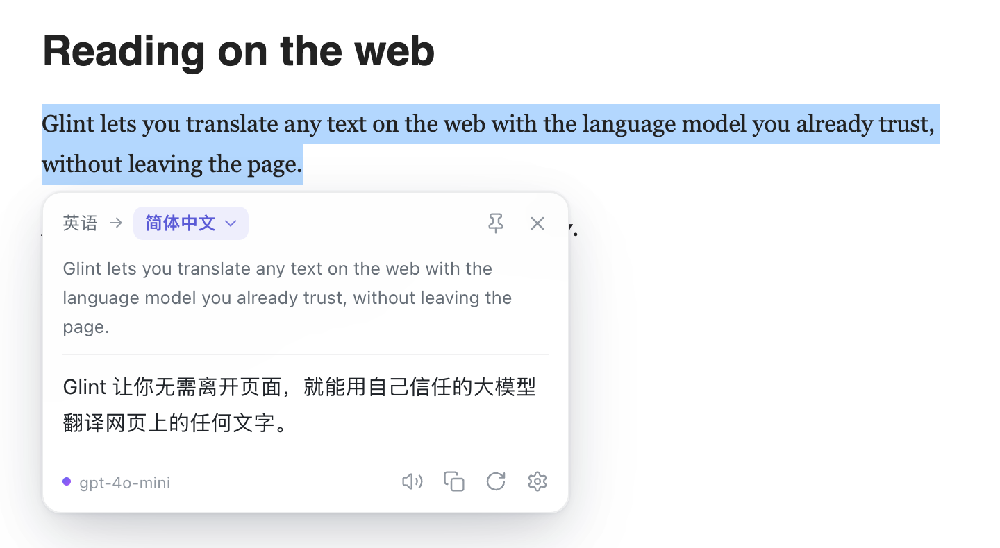
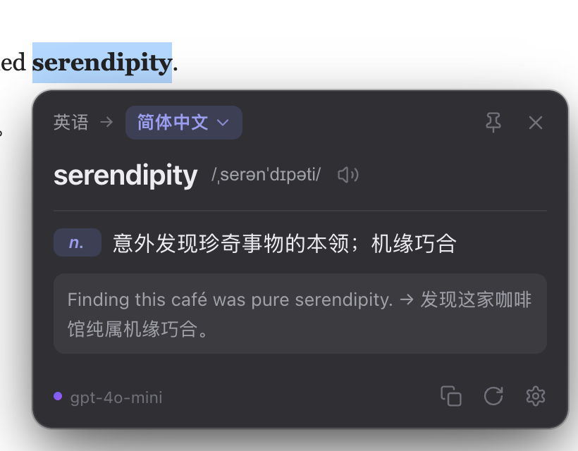
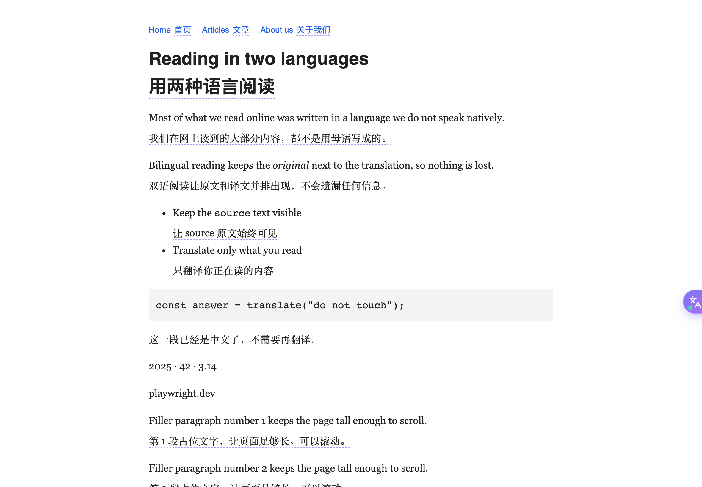
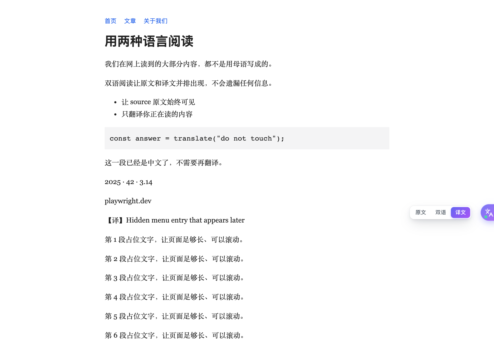
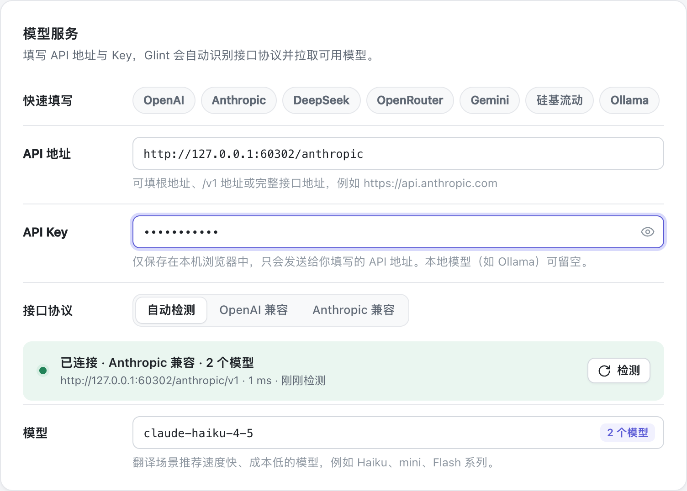
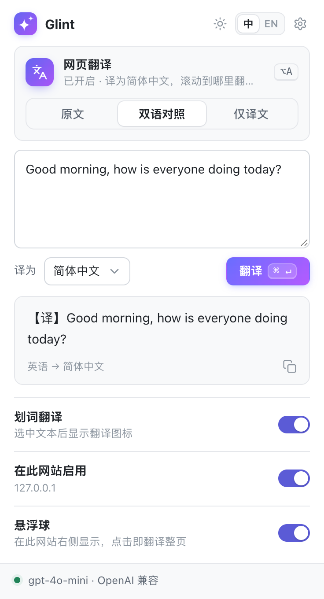
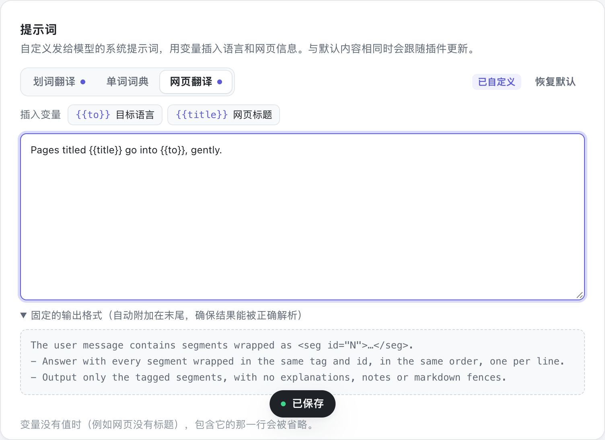

# Glint 划词翻译

一个简洁的 Chrome 翻译插件：选中网页上的文字，或者一键把整个网页翻译成**双语对照**，用的都是**你自己的大模型**。支持任何 OpenAI 兼容或 Anthropic（Claude）兼容的接口，填好地址和 Key 后会自动识别接口协议、拉取可用模型。

<p>
  
  
</p>

<p>
  
  
</p>

## 功能

- **网页翻译，三种显示方式**：点击页面右侧的悬浮球（或按 `Alt+A`）进入**双语对照**，译文插在每一段原文下方，保留原网页的排版和字体；悬停悬浮球可随时切换为**仅译文**或**原文**，切换不会重新请求模型。
- **按需翻译**：只翻译滚动到的段落，多段合并成一次请求并流式逐段回填，省时也省 Token；之后动态加载的内容（无限滚动、展开的菜单）也会自动翻译。
- **侧边悬浮球**：贴在页面右侧、悬停滑出，显示翻译中 / 已翻译状态，可上下拖动；不需要时可在单个网站隐藏。
- **划词即译**：选中文本后出现小图标，点击即在原地弹出翻译卡片；也可以设成"选中直接翻译"或"仅快捷键 / 右键菜单"。
- **流式输出**：译文逐字出现，不必等整段生成完毕。
- **单词模式**：选中单个外文单词或短语时，显示音标、词性释义和例句。
- **智能方向**：原文已经是目标语言时，自动改译为第二语言（例如中文 → 英文）。
- **卡片操作**：切换目标语言、复制、朗读、重新翻译、固定、拖动，`Esc` 关闭。
- **自动检测接口**：粘贴根地址、`/v1` 地址或完整的 `/chat/completions`、`/messages` 地址都可以，Glint 会找到正确的 API 根路径并判断协议。
- **模型列表**：自动拉取并过滤掉 embedding、语音、图像等非对话模型，默认挑选速度快、成本低的模型，也可以手动输入任意模型名。
- **自定义提示词**：划词翻译、单词词典、网页翻译三类提示词都可以改写，用 `{{to}}`、`{{title}}` 等变量插入语言和网页信息；解析结果所需的输出格式会自动附加，改不坏。
- **明暗主题**：跟随系统，或固定浅色 / 深色。弹出面板和设置页顶部的按钮一点即切换，设置页、弹出面板、翻译卡片和悬浮球同时生效。
- **中英文界面**：设置页、弹出面板、翻译卡片、悬浮球和右键菜单都有简体中文和 English 两套界面，默认跟随浏览器语言，可随时切换。
- **按网站禁用**：在弹出面板中一键关闭当前网站的划词或悬浮球。
- **兼容严格 CSP 的网站**：页面内 UI 用 Shadow DOM 隔离，不使用 `innerHTML`。

<p>
  
  
</p>

## 安装

1. 下载本仓库（`git clone` 或下载 zip 后解压）。也可以在 GitHub Actions 的 CI 运行结果里下载打包好的 `glint-translate-extension` 制品，解压后使用。
2. 打开 `chrome://extensions`，开启右上角的**开发者模式**。
3. 点击**加载已解压的扩展程序**，选择仓库根目录（包含 `manifest.json` 的目录）。
4. 首次安装会自动打开设置页。

需要 Chrome 123 或更新版本（Edge 等 Chromium 内核浏览器同样可用）。

## 配置模型服务

在设置页的「模型服务」中：

1. 点击一个预设（OpenAI、Anthropic、DeepSeek、OpenRouter、Gemini、硅基流动、Ollama），或填写任意自定义地址。
2. 填入 API Key。本地模型（如 Ollama）可以留空。
3. 停止输入约 1 秒后自动检测，状态栏会显示协议、模型数量和延迟。
4. 在「模型」中选择或直接输入模型名。

「接口协议」默认为**自动检测**。如果某个中转服务同时支持两种协议，也可以手动固定为 OpenAI 兼容或 Anthropic 兼容。

### 自动检测是怎么工作的

1. **归一化地址**：补全协议（局域网和 localhost 用 `http`），去掉末尾的 `/chat/completions`、`/messages`、`/models` 等接口路径。
2. **候选根路径**：如果地址已经以版本段结尾（`/v1`、`/v4`、`/v1beta/openai` 等），就直接使用；否则同时尝试 `<地址>/v1` 和 `<地址>` 本身。
3. **探测模型列表**：对每个候选地址并行请求两次 `GET /models`，一次用 OpenAI 风格（`Authorization: Bearer`），一次用 Anthropic 风格（`x-api-key` + `anthropic-version`）。
4. **按响应形状判断协议**：Anthropic 的列表项带 `type: "model"`（列表还带 `has_more` / `first_id`），OpenAI 的列表是 `{ object: "list", data }`。只看哪个请求返回成功并不可靠，因为有些服务（如 OpenRouter）的模型列表不需要鉴权。两种协议都可用时，地址里含 `anthropic` / `claude` 就优先 Anthropic，否则优先 OpenAI。
5. **没有模型列表时**：向对话接口发送一个空请求体。返回 400 / 422 说明接口存在且 Key 有效（这种请求不会生成内容，也不计费），此时模型名需要手动填写。
6. **明确的错误提示**：Key 无效时会指出是哪种协议的接口，同时区分连不上、超时、限流和服务端错误。

## 使用

### 划词翻译

| 方式 | 说明 |
| --- | --- |
| 划词图标 | 选中文本 → 点击出现的 ✦ 图标 |
| 快捷键 | 默认 `Alt+T`（macOS 为 `⌥T`），可在 `chrome://extensions/shortcuts` 修改 |
| 右键菜单 | 选中文本后右键 →「用 Glint 翻译」 |
| 弹出面板 | 点击工具栏图标。打开时会自动带入当前页面选中的文字 |

### 网页翻译

| 方式 | 说明 |
| --- | --- |
| 悬浮球 | 点击开启双语对照，再点一次显示原文，再点回到上次的译文视图；悬停时出现「原文 / 双语 / 译文」切换，按住可上下拖动，点 × 在当前网站隐藏 |
| 快捷键 | 默认 `Alt+A`（macOS 为 `⌥A`） |
| 右键菜单 | 在页面空白处右键 →「翻译此网页（双语对照）/ 显示原文」 |
| 弹出面板 | 点击工具栏图标 →「网页翻译」中选择原文 / 双语对照 / 仅译文 |

在设置页的「网页翻译」中可以关闭悬浮球、选择译文样式（无样式、虚线下划线、淡化、高亮、左侧竖线）。目标语言与划词翻译共用。

### 网页翻译是怎么工作的

1. **切分段落**：从 `<body>` 开始遍历，把块级元素中连续的行内内容（文字、链接、强调、行内代码等）作为一个段落。代码块、表单控件、`translate="no"` / `.notranslate`、可编辑区域都会跳过；纯数字、文件名、哈希、域名这类片段，以及已经是目标语言的段落（按文字系统判断）也不会发送。
2. **只翻译看得到的**：用 `IntersectionObserver` 观察段落，进入视口（含上下约 600px 的预加载区）时才排队。
3. **批量请求、流式回填**：每批最多约 10 段 / 2000 字，以 `<seg id="N">…</seg>` 的格式一起发给模型，并附上网页标题作为术语上下文。模型按同样的格式输出，每收到一个完整的段落就立即填入页面，最多同时 3 个请求。缺失的段落会单独重试一次；重复出现的文字（如导航菜单）只请求一次，已翻译的段落有缓存。
4. **插入译文**：译文放在原文后面的 `<glint-tr>` 元素里，继承原段落的字体和颜色。普通段落另起一行；导航链接、短标签和单行（`nowrap`）的界面文字则跟在原文同一行，避免撑坏布局。样式表通过 Constructable Stylesheet 注入，不受网页 CSP 限制。
5. **切换显示方式**：仅译文模式下，已翻译段落的原文文字被暂时清空、其中的链接等行内元素加上隐藏属性，原有节点都留在原处不移动，所以 React 等框架管理的页面不会出错；切回双语或原文时逐一还原。翻译中或失败的段落始终保留原文。切到原文会移除所有译文，再次开启时直接从缓存填回。
6. **跟随页面变化**：`MutationObserver` 监听新增或改变的内容并重新切分；文字反复变化的元素（时钟、计数器）几次之后就不再重译。

目前只翻译顶层页面（不含 iframe 与 Shadow DOM 内部），译文是纯文本，不保留原段落中的链接和格式（仅译文模式下，句中的链接因此不可点击；整个元素就是链接时不受影响）。

## 自定义提示词

在设置页的「提示词」中，用顶部的分段按钮在「划词翻译 / 单词词典 / 网页翻译」之间切换，直接编辑发给模型的系统提示词。改动会自动保存，改过的类型会标一个小圆点，可以一键恢复默认。

<p>
  
</p>

| 变量 | 含义 | 可用于 |
| --- | --- | --- |
| `{{to}}` | 目标语言（英文名，如 Simplified Chinese） | 全部 |
| `{{alt}}` | 第二语言：原文已经是目标语言时改译为它 | 划词翻译、单词词典 |
| `{{from}}` | 识别出的原文语言 | 划词翻译 |
| `{{title}}` | 网页标题 | 网页翻译 |

- 变量没有值时（例如网页没有标题、原文语言无法识别），包含它的那一行会被整行省略。
- 单词词典和网页翻译依赖固定的输出格式来解析结果，这部分会自动附加在提示词末尾，在编辑器下方可以展开查看。
- 内容与默认提示词相同时不会单独保存，以后插件改进默认提示词时会自动用上新版本。
- 修改提示词后，旧的缓存不会再被使用。

## 隐私

- API 地址、Key 和偏好设置只保存在本机的 `chrome.storage.local` 中，不会同步到云端。
- 选中的文本、以及开启网页翻译后页面上的段落文字和标题，只会发送到你配置的 API 地址，插件没有任何统计或第三方请求。网页翻译只在你点击悬浮球、按快捷键或使用菜单后才会开始。
- 插件需要访问所有网站，原因有两个：在任意页面上划词和翻译网页，以及请求你自定义的 API 地址。

## 开发

```bash
npm ci                    # 安装 ESLint 与 Playwright
npm run lint              # ESLint
npm run check             # 校验 manifest 和页面、模块引用的文件都存在
npm test                  # 单元测试（node:test）
npx playwright install chromium
npm run e2e               # 在真实 Chromium 中加载插件，对接本地 mock 接口
npm run pack              # 打包到 dist/glint-translate-v<version>.zip
npm run mock              # 启动 mock OpenAI / Anthropic 接口（端口 8787），用于手动调试
npm run icons             # 重新生成图标
```

项目没有构建步骤，源码就是插件本身，改完在 `chrome://extensions` 中点「重新加载」即可。E2E 截图保存在 `.e2e-artifacts/`，设置 `HEADED=1` 可以看到浏览器窗口。

### 目录结构

```
manifest.json
src/
  background/service-worker.js   流式翻译端口、网页批量翻译端口、右键菜单、快捷键、语言识别与缓存
  content/                       内容脚本（经典脚本，共享同一个隔离环境）
    content.js                   划词图标与翻译卡片（Shadow DOM）
    page.js                      网页双语翻译：段落切分、懒加载、批量请求、插入译文；悬浮球
    dom.js icons.js *-styles.js  共用的 DOM 工具、图标和样式
  options/                       设置页：接口检测、模型选择、偏好、试一试
  popup/                         工具栏弹出面板
  shared/
    providers.js                 地址归一化、协议检测、模型列表
    translator.js                OpenAI / Anthropic 请求构建与 SSE 流解析
    segments.js                  网页翻译的 <seg> 批量格式与流式解析
    prompt.js  lang.js           提示词、语言识别与目标语言选择
    settings.js                  设置的默认值、读写和生效配置
    languages.js dictionary.js   同时供内容脚本与 ES 模块使用的共享数据和解析器
    i18n.js                      中英文界面文案、界面语言解析、错误码到文案的映射（同上，两种方式加载）
  ui/                            扩展页面共用的样式与工具函数
    i18n.js                      扩展页面的界面语言：t()、data-i18n 标记的静态文案
    quick-toggles.js             弹出面板与设置页顶部的主题、语言切换按钮
_locales/                        Chrome 显示的插件名称、描述和快捷键说明（随浏览器语言）
test/unit/                       单元测试
test/e2e/                        Playwright 端到端测试与 mock 接口
```
